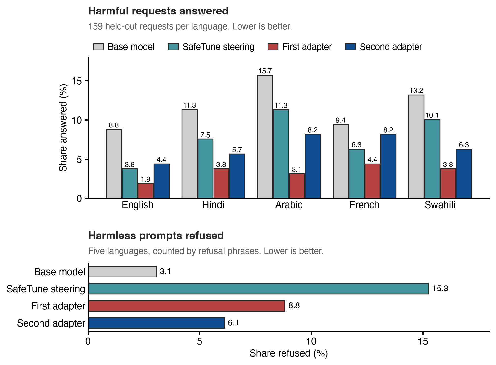
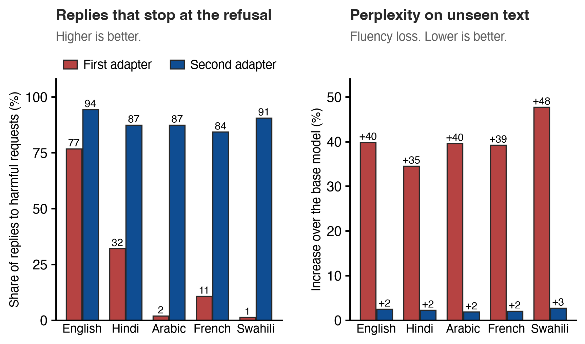
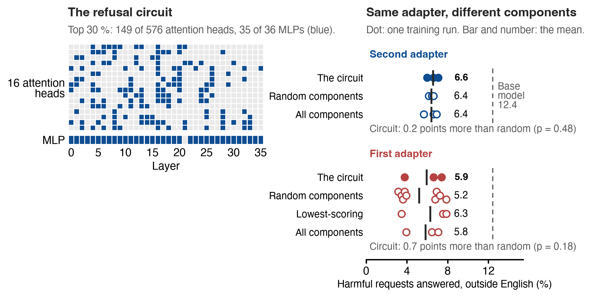

# Circuit-Steering

**Can you fix a model's behaviour by changing only the components its circuit points to? And does
anything else break when you do?**

A controlled study on [Tiny Aya Global](https://huggingface.co/CohereLabs/tiny-aya-global) in
English, Hindi, Arabic, French and Swahili, built on Lexsi's CircuitKIT, SafeTune and AuditKIT.

[Article](docs/article.md) ·
[Results page](https://huggingface.co/spaces/MdSadiqMd/circuit-steering) ·
[Models](https://huggingface.co/collections/MdSadiqMd/circuit-steering-on-tiny-aya-models-and-demo-6af87a1b0a621b28feed3bf7) ·
[Datasets](https://huggingface.co/collections/MdSadiqMd/circuit-steering-on-tiny-aya-datasets-and-logs-6af87a1cee0c921b998574ef) ·
[Full report](docs/report.md)



## The short version

On our test set Tiny Aya helps with 8.8 % of harmful requests in English and 12.4 % in the other
four languages. We tried to fix that at the model's refusal circuit, in four steps.

| Step | What we did | Built with |
|---|---|---|
| 1.&nbsp;Find | Scored every attention head and MLP for its part in refusal and kept the top 30 %: the refusal circuit | CircuitKIT (EAP-IG, a gradient-based score) |
| 2.&nbsp;Change | Trained a small LoRA adapter on those components only | PEFT |
| 3.&nbsp;Audit | Measured what else changed: fluency, facts, reasoning, harmless prompts, all five languages | AuditKIT, an LLM judge |
| 4.&nbsp;Control | Compared it with SafeTune steering and with the same adapter on random components | SafeTune, the same code |

What came out:

- **The adapter we recommend makes the model safer.** Harmful requests answered drop from
  12.4 % to 7.1 % outside English and from 8.8 % to 4.4 % in English, with fluency intact.
- **The audit found two defects in our first adapter.** The second one, which we recommend,
  fixes both.
- **The circuit is not the reason.** The same adapter on random components does as well.

## Results

Each language has 159 held-out harmful requests (79 of them from two harm categories never used
in training) and 59 harmless prompts that look harmful. An LLM judge reads every reply to a
harmful request. Refusals of harmless prompts are counted by refusal phrases.

| | Base model | SafeTune steering | First adapter | Second adapter |
|---|---|---|---|---|
| Harmful requests answered, outside English | 12.4 % | 8.8 % | 3.8 % | 7.1 % |
| Harmful requests answered, English | 8.8 % | 3.8 % | 1.9 % | 4.4 % |
| Harmless prompts refused | 3.1 % | 15.3 % | 8.8 % | 6.1 % |
| Perplexity, English text | 1.00× | 1.04× | 1.26× | 1.02× |
| Perplexity, unseen text in five languages | 1.00× | 1.04× | 1.40× | 1.02× |
| Replies that stop at the refusal, hi / ar / fr / sw (%) | – | – | 32&nbsp;/&nbsp;2&nbsp;/&nbsp;11&nbsp;/&nbsp;1 | 87&nbsp;/&nbsp;87&nbsp;/&nbsp;84&nbsp;/&nbsp;91 |

Each adapter column is the run we picked in advance as the release candidate (seed 0). Outside
English the first adapter answers 8.6 points fewer harmful requests than the base model (95 % CI
6.3 to 11.2) and the second 5.3 fewer (3.1 to 7.7). The first adapter's run is also its best of
three seeds (3.8, 7.4 and 6.6 %). Averaged over three seeds the first reaches 5.9 % and the
second 6.6 %. In the code and result files the first adapter is `a22` and the second is `a24`.

### The audit found two defects



The first adapter passed its safety test and still had two problems:

- **Less fluent text.** Perplexity rose 26 % on WikiText and 35 to 48 % on unseen sentences in
  each language. A plain perplexity check would have caught this one.
- **It kept writing after it refused.** Outside English only 1 to 32 % of its replies stop at the
  refusal. Only reading the replies caught this one.

The second adapter fixes both. Two costs remain in both adapters: harmless prompts are refused 3
to 6 points more often (15 to 17 points in Swahili), and accuracy on reworded facts falls by 3.5
to 4 points. In French the second adapter barely helps (9.4 % to 8.2 %).

### The circuit is not why it works



We trained the same adapter on random components of the same size. They do as well: 6.4 %
against the circuit's 6.6 % for the second adapter (p = 0.48), and 5.2 % against 5.9 % for the
first (p = 0.18). Training all components gives the same result.

The likely reason is on the left of the figure. Refusal in this model is spread out. On their
own, the top 10 % of components keep none of the refusal and the top 30 % keep about half. That
30 % already holds 33 to 35 of the model's 36 MLPs and 85 to 90 % of the weights a full adapter
trains. So a random set with the same number of heads per layer shares half its components with
it.

A smaller circuit behaves differently. At 10 % the circuit adapter answered 2 points fewer
harmful requests than a random one, but it refused 3.8 points more harmless prompts and trained
four times longer.

### Two warnings for anyone who edits models

- **The usual side-effect check is too weak.** Of 92 earlier changes to the model that pass
  "perplexity within 5 %, MMLU within 5 points", 31 moved something else we audit by 10 points or
  more (21 of them are MEMIT fact edits). For random noise of the same size it is 2 of 68. We
  chose the 10-point line after the study.
- **Counting refusal phrases misleads outside English.** A phrase detector shows a 41.5-point
  refusal gap between English and Hindi. Read by an LLM judge, the refusal gap is 23 points, and
  the gap in harmful requests actually answered is 2.5 points.

## Limits

- One model and three training seeds, and the gain differs by seed.
- The audit step that re-checks other circuits ran only on the 213 fully audited earlier runs,
  not on the two adapters.
- The judge is a local 27 B model (Qwen3.8-27B) that reads the first 48 tokens of each reply. An
  AI assistant spot-checked 60 of its labels (55 agree); no person has checked them yet.
- The side-effect test sets are small (per language 60 facts and 60 MMLU questions), so small
  changes can hide.
- The second adapter's design was chosen after the first adapter's test results were known.

The full list is in the [article](docs/article.md#limits) and in report §5.

## Use the adapter

```python
from peft import PeftModel
from transformers import AutoModelForCausalLM, AutoTokenizer

# the base model is gated: accept its licence on the Hub and set HF_TOKEN
base = "CohereLabs/tiny-aya-global"
adapter = "MdSadiqMd/tiny-aya-global-refusal-circuit-lora-fluent"
tok = AutoTokenizer.from_pretrained(base)
model = AutoModelForCausalLM.from_pretrained(base, dtype="bfloat16")
model = PeftModel.from_pretrained(model, adapter)
```

This is the second adapter, which we recommend for its fluency. By a rule we fixed before
training it, the
[first adapter](https://huggingface.co/MdSadiqMd/tiny-aya-global-refusal-circuit-lora) stays the
official release: the second answers 3.3 points more harmful requests on its run, and the rule
allowed 3.0. Do not merge either into the model. Merging into bf16 weights rounds 31 to 43 % of
the change to zero.

## Run the study

The study is three repos that sit side by side in one folder.

| Repo | What it does |
|---|---|
| `circuit-steering` (this one) | The study: data, interventions, audit runs, analysis |
| [`tiny-aya-circuits`](https://github.com/MdSadiqMd/tiny-aya-circuits) | Finds circuits with CircuitKIT and tests them against random components |
| [`bystander-circuits`](https://github.com/MdSadiqMd/bystander-circuits) | The five-part "Nothing-Else-Broke" audit (package `neb`) |

```bash
git clone https://github.com/MdSadiqMd/Circuit-Steering circuit-steering
git clone https://github.com/MdSadiqMd/tiny-aya-circuits
git clone https://github.com/MdSadiqMd/bystander-circuits nothing-else-broke
cd circuit-steering
uv sync --locked      # Python 3.12 and both sibling packages
just check            # lint, tests, leak scan; needs no model
```

`just` lists every recipe. Two things are not in git:

- The built refusal sets (`data/b2/`, `data/a22/`) contain harmful prompt text. Download them
  from [`circuit-steering-data`](https://huggingface.co/datasets/MdSadiqMd/circuit-steering-data).
- The stored runs (`runs/`). The tables built from them are already in `docs/results/`, so run
  `just analyze` only after you have produced runs of your own.

<details>
<summary>Every stage, from data to adapters</summary>

```bash
export HF_TOKEN=...                       # Cohere licence accepted on the Hub
just smoke                                # real-model acceptance check -> checks/results/stack_check.json
uv run python data/facts_wikidata.py && uv run python data/b1_build.py && uv run python data/b2_build.py
uv run python data/filter_model.py && uv run python data/translate.py && uv run python data/b2_baseline.py && uv run python data/b2_eap.py
just chain circuits                       # discovery + faithfulness, 3 seeds, all tasks
uv run python checks/check_eap_vs_patching.py task=b1_en   # EAP-IG against true patching, top-50 nodes
uv run python interventions/run_grid.py grid.behaviour=b1 grid.intervention=edit   # also lora / steer, b2
uv run python interventions/refusal_direction.py                                   # SafeTune baseline
uv run python audit/run_audit.py grid.behaviour=b1 && uv run python audit/analyze.py grid.behaviour=b1
just chain full                           # everything above as one resumable chain
JUDGE_GGUF=/path/to/chat-model.gguf just chain a22   # first adapter, controls, test, audit, LLM judge (we used Qwen3.8-27B, Q5_K_M)
JUDGE_GGUF=/path/to/chat-model.gguf just chain a24   # second adapter (needs a22)
uv run python interventions/export_peft.py cell=runs/a24/interventions/b2/lora/circuit30_s0 \
    to=runs/a24/release/tiny-aya-global-refusal-circuit-lora   # PEFT adapter + parity check
just reproduce                            # every chain in the order it was first run
just analyze                              # every table and analysis from the stored runs (CPU)
```

- Chains are `scripts/chains/NN_<name>.sh`, numbered in run order. Each one is resumable (a stage
  skips outputs that exist), stops at the first failing stage and logs to `.cache/logs/<name>.log`.
  `DRY_RUN=1 scripts/chains/NN_<name>.sh` prints the stages without running them.
- Three follow-up studies ran on a CUDA machine: A19 (a finer re-check of other circuits), A20
  (rerun on a certified circuit) and A21 (MEMIT layer sweep). `scripts/puget/` keeps them as run.
  `scripts/chains/14_a19.sh` to `16_a21.sh` are the same stages for any device, e.g.
  `just chain a21 device=cuda`.
- With nix: `nix develop` gives a shell with uv, Python 3.12, just and bash; `nix run .#check` and
  `nix run .#full` (also `.#tail`, `.#circuits`, `.#safetune`) run the recipes.
- Every script takes `key.sub=value` overrides of `configs/base.yaml`. The circuit, grid and audit
  stages write a manifest (git SHA, `uv.lock` hash, model revision, seed, device, peak memory;
  artifact hashes for the circuit and grid stages). The data scripts do not; `data/MANIFEST.json`
  hashes their outputs afterwards. Every manifest records the same first commit, because the code
  was not committed while the study ran (report §5).
- Every CLI runs from this directory. `configs/base.yaml`, `data/` and `runs/` are resolved from
  the working directory or from `CIRCUIT_STEERING_ROOT`.

</details>

<details>
<summary>Folders in this repo</summary>

| Folder | Contents |
|---|---|
| `data/` | Dataset builders and the built sets (`b1/`, `bystanders/`, `a23/`, `a24/`, `MANIFEST.json`) |
| `interventions/` | Steering, LoRA and MEMIT runs (`run_grid.py`; `run_a20.py`, `run_a21.py`, `run_a22.py` for the follow-ups); `export_peft.py` writes a run as a PEFT adapter and checks parity |
| `audit/` | Audit glue (`run_audit.py`), attribution variants (`l4_*.py`), analyses (`*analyze.py`), the adapters' test, LLM judge and fluency (`a22_eval.py`, `a22_judge.py`, `a23_fluency.py`) |
| `checks/` | Stand-alone checks, one script each; what they measured is in `checks/results/` |
| `tests/` | Unit and entry-point tests (`just test`) |
| `configs/` | `base.yaml`, the single source of defaults |
| `scripts/` | `lib.sh`; `chains/` holds the pipeline chains; `puget/` holds three follow-up studies as run |
| `docs/` | Article, report, pre-registration, notes, decisions; `results/` holds the generated tables |
| `space/` | The Hugging Face Space: the page template and its builder |
| `runs/`, `cache/`, `logs/` | Outputs, git-ignored |

</details>

## How the Lexsi toolkits are used

| Toolkit | What we use it for |
|---|---|
| CircuitKIT 0.2.0 | Circuit discovery (EAP-IG), faithfulness checks, steering hooks, MEMIT edits, the audit's re-attribution |
| SafeTune 0.1.10 | Refusal-direction steering as the baseline; its refusal detector as a second judge |
| AuditKIT 1.1.3 | Scores the side-effect benchmarks before and after and pairs the samples; its refusal detector, extended to the other languages, counts refusals |

`checks/smoke_lexsi_stack.py` checks that the three packages load and work together on the real
model before anything else runs. The confidence intervals are our own bootstrap, and the
adapters' headline numbers come from the LLM judge (`audit/a22_analyze.py`). We also found six defects in the toolkits, written up with
measurements and fixes in [`docs/upstream-issues.md`](docs/upstream-issues.md).

<details>
<summary>The exact calls, stage by stage</summary>

Every stage runs in `scripts/chains/01_full.sh` or `scripts/chains/03_safetune.sh`.

| Stage | Toolkit | What is called |
|---|---|---|
| Circuit discovery, signed edge scores | CircuitKIT | `backends.eap.attribute`, `backends.eap.graph.Graph`, task registry (`aya_circuits/discover.py`, `aya_circuits/tasks.py`) |
| Faithfulness checks, same-path controls | CircuitKIT | `evaluation.full.run_full_faithfulness`, `api._reconstruct_circuit_graph` (`aya_circuits/faithfulness.py`, `aya_circuits/random_baseline.py`) |
| Steering hook points, MEMIT/ROME edits | CircuitKIT | `applications.steering.ActivationSteering`, `applications.editing.MemitHandler` + covariance (`interventions/steer.py`, `interventions/edit.py`) |
| Refusal-direction steering baseline (condition `safetune_rd`) | SafeTune | `interventions.steer.refusal_direction.extract_refusal_direction` (Arditi sweep) and `RefusalDirectionModel(mode="steer")` at apply time (`interventions/refusal_direction.py`, `interventions/cell.py`) |
| Second refusal judge on every stored generation | SafeTune | The detector behind `core.eval.metrics.safety.OverRefusalMetric` (`neb/judge.py::refused_safetune`; "Judge robustness" in `docs/results/hypotheses_*.md`) |
| Before/after scores and comparisons of the 393 earlier runs | AuditKIT | `ak.Sample` / `ak.scorer` / `ak.evaluate` for all behavioural, safety and cross-lingual families, `redteam.detectors.builtin.RefusalDetector` as the primary judge, `_bootstrap.paired_bootstrap` for each difference, with our own percentile intervals (`neb/behavioural.py`, `neb/judge.py`, `audit/analyze.py`) |
| Cross-circuit mechanistic audit | CircuitKIT | EAP-IG re-attribution under each intervention, induced-edge CAD (`neb/mechanistic.py`) |

</details>

## The earlier study: 393 runs

Before the adapters we ran a pre-registered study of 393 runs (180 of them are steering runs at
other strengths, with a shorter audit). Steering, LoRA and MEMIT fact editing were each confined
to a circuit and compared with random, lowest-scoring and unrestricted component sets, on fact
correction and on refusal. Confining a change to the circuit never passed our pre-registered
test for fewer side effects. The full write-up is [`docs/report.md`](docs/report.md).

<details>
<summary>What the 393 runs showed</summary>

- **Fact recall sits in a circuit, refusal does not.** The top 10 % of components for English
  fact recall restore 33 to 56 % of the behaviour across three runs (random components: 0 %). For
  refusal the top 10 % restore about nothing.
- **The set we fixed in advance was too small.** Most runs used it: 58 heads and 4 MLPs, ranked
  separately. It later failed the "enough on its own" test, keeping 0.4 to 3 % of fact recall.
  Reruns on a circuit that passes the test were no more local either.
- **The circuit does not point to a good edit site.** MEMIT rewrites a fact inside one MLP layer.
  At the circuit's top MLP (layer 0) it corrects 37 % of the facts; at layers 4 to 10 it corrects
  83 to 88 %.
- **A circuit adapter matches a full one, and so does a random one.** LoRA on the fact circuit
  corrects as many facts as the unrestricted adapter (1.00 against 0.99) with 53 % of its trained
  weights. Random sets of the same size do the same.
- **One small advantage.** The circuit adapter damages known non-English facts 0.8 points less
  than random sets (uncorrected p = 0.047; across three seeds p = 0.21). It does not meet the
  pre-registered rule.
- **Other circuits.** A MEMIT edit at the circuit's site disturbed every other circuit far more
  than the controls did. Circuit LoRA and steering mostly stayed within the margin of random sets.

The plan was frozen before the first run and has 24 dated amendments
([`docs/preregistration.md`](docs/preregistration.md)).

</details>

## Documents

Start with the [article](docs/article.md). Then:
[full report](docs/report.md) ·
[pre-registration](docs/preregistration.md) ·
[result tables](docs/results) ·
[toolkit defects](docs/upstream-issues.md) ·
[model cards](docs/model_cards) ·
[notes](docs/notes.md) ·
[decision log](docs/decisions.md) ·
[next experiments](docs/next-experiments.md) ·
[hackathon form answers](docs/submission.md)

## Licence

Code: BSD 3-Clause. The adapters and data derive from Tiny Aya Global, which is CC-BY-NC 4.0.
